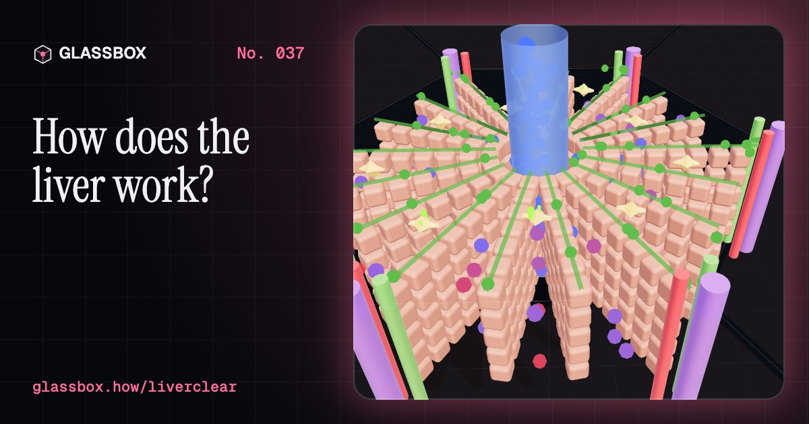
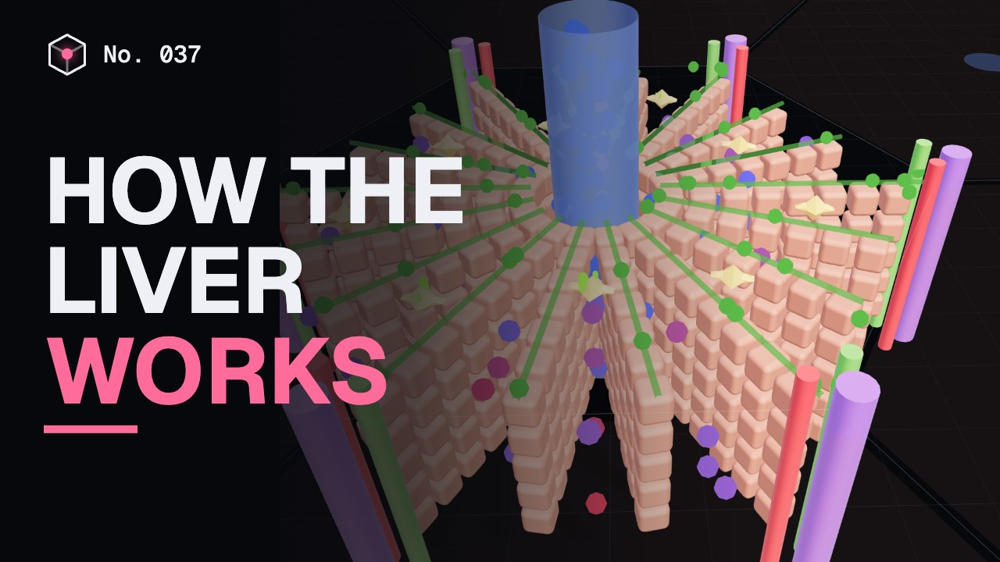
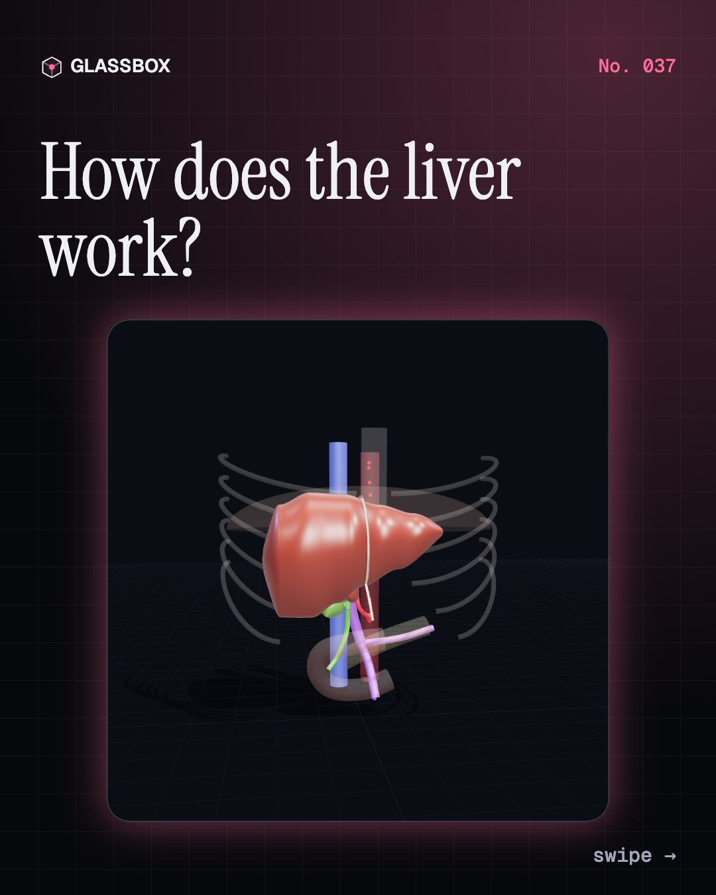
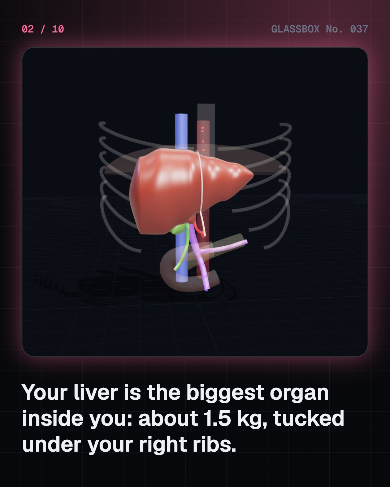
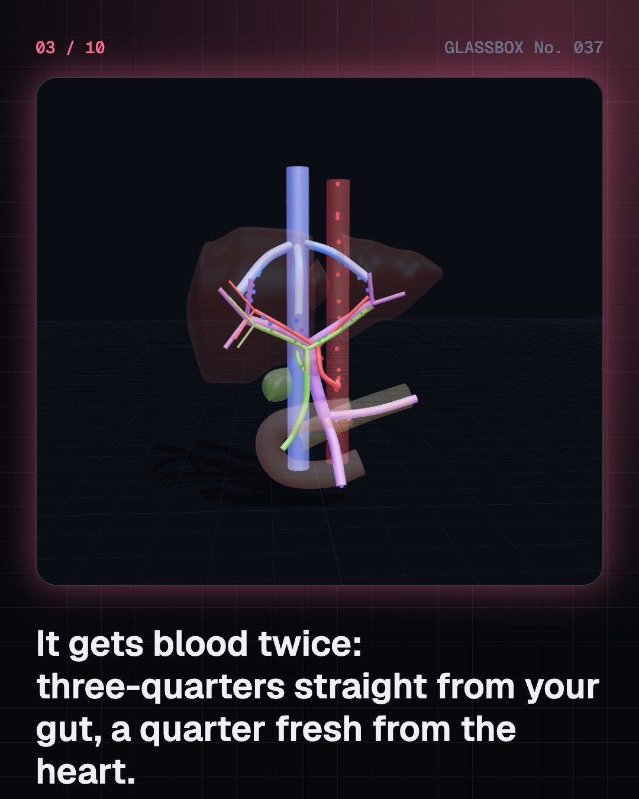
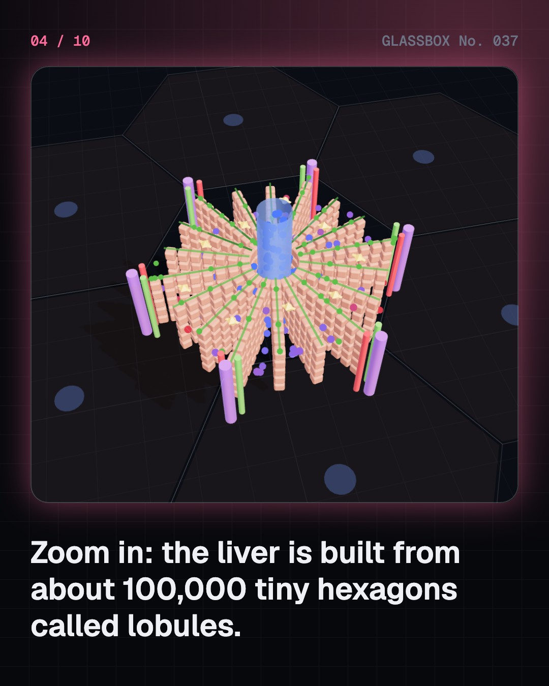

<!-- glassbox:start -->
<!-- Generated from glassbox.json by the Glassbox hub (npm run readme -- liverclear). Edit glassbox.json, not this block. -->
<p align="center"><a href="https://glassbox-production-fd52.up.railway.app/e/liverclear/"></a></p>

<h1 align="center">LiverClear</h1>

<p align="center"><b>How does the liver work?</b><br>Your liver gets blood from two pipes, stores your sugar overnight, turns poison into waste and can grow back after most of it is removed. Zoom from the whole organ into its tiny hexagons and watch blood and bile flow opposite ways.</p>

<p align="center"><a href="https://glassbox-production-fd52.up.railway.app/liverclear/"><b>▶ Play with it</b></a> &nbsp;·&nbsp; <a href="https://glassbox-production-fd52.up.railway.app/e/liverclear/">Read the 60-second explainer</a> &nbsp;·&nbsp; <a href="https://glassbox-production-fd52.up.railway.app/liverclear/glassbox/reel.mp4">Watch the 40-second video</a></p>

<p align="center">
  <a href="https://glassbox-production-fd52.up.railway.app/e/liverclear/"></a>
  <a href="https://glassbox-production-fd52.up.railway.app/e/liverclear/"></a>
  <a href="LICENSE"></a>
  <a href="LICENSE-CONTENT.md"></a>
  <a href="#privacy"></a>
</p>

## In 60 seconds

1. **Two blood supplies.** The liver is the largest organ inside you, about 1.2 to 1.5 kg, under your right ribs. About three-quarters of its blood comes straight from the gut through the portal vein, and a quarter fresh from the heart through the hepatic artery: about 1.35 litres a minute in all, roughly a quarter of the heart's output.
2. **100,000 tiny hexagons.** The liver is built from 50,000 to 100,000 six-sided lobules, 1 to 2 mm across. Blood trickles in from the corners to a central vein, past plates of liver cells, while bile flows the other way to the corners. Kupffer cells in the channels catch almost every bacterium from the gut.
3. **The sugar bank.** After meals, insulin tells the liver to store glucose as glycogen, up to about 100 g. Between meals and overnight, glucagon tells it to release glucose and make new glucose, keeping blood sugar steady at about 70 to 140 mg/dL. It also makes albumin, clotting factors and cholesterol.
4. **Cleaning the blood.** The liver turns toxic ammonia into urea for the kidneys to remove, breaks down medicines and alcohol at a roughly steady pace that no trick can speed up, and turns the pigment of old red blood cells into bilirubin, which leaves in bile. If bile backs up, skin and eyes turn yellow: jaundice.
5. **Bile breaks up fat.** The liver makes about half a litre to a litre of bile a day. The gallbladder stores and concentrates it, then squeezes it into the gut after a meal. Bile salts split fat into droplets smaller than a thousandth of a millimetre, giving digestive enzymes up to 1,000 times more surface.
6. **Regrowing and going wrong.** Up to about 70% of a liver can be removed and the rest grows back to about full size in two to three months, which makes living-donor transplants possible. Fatty liver affects about 3 in 10 adults, hepatitis B and C viruses infect hundreds of millions, and years of damage can end in cirrhosis. For your own liver, talk to a doctor.

## Words worth knowing

| Term | Meaning |
|---|---|
| **Portal vein** | The vein that brings blood from the stomach, intestines and spleen to the liver, about three-quarters of its supply. |
| **Hepatic artery** | The artery that brings oxygen-rich blood to the liver, about a quarter of its supply. |
| **Lobule** | A tiny six-sided unit of the liver, 1 to 2 mm across, with portal triads at its corners and a central vein in the middle. |
| **Hepatocyte** | The main liver cell, which stores sugar, builds proteins, makes bile and breaks down toxins. |
| **Glycogen** | A branching chain of glucose units: the liver's store of sugar, up to about 100 g. |
| **Insulin and glucagon** | Hormones from the pancreas: insulin tells the liver to store glucose, glucagon tells it to release glucose. |
| **Urea cycle** | A loop of reactions in liver cells that turns toxic ammonia into harmless urea. |
| **Bile** | A yellow-green liquid made by the liver. Its bile salts break fat into tiny droplets so it can be digested. |
| **Cirrhosis** | Severe, lasting scarring of the liver after years of damage, which stops it working well. |

## A short history

**4,000 years from clay livers used to read the future to pills that cure hepatitis C and livers that regrow after being shared.**

- **1750 BCE** · A clay liver for training priests (Babylonian diviners (bārû priests), Sippar, Babylonia (Iraq))
- **700 BCE** · The liver that grew back (Hesiod (poet), Boeotia, Greece)
- **1833** · The liver is made of tiny six-sided units (Francis Kiernan, London, England)
- **1848** · The liver makes sugar (Claude Bernard, Paris, France)
- **1932** · The urea cycle: poison into waste (Hans Krebs and Kurt Henseleit, Freiburg, Germany)
- **1965** · A clue in the blood: hepatitis B (Baruch Blumberg, Philadelphia, USA)
- **1967** · The first successful liver transplant (Thomas Starzl and team, Denver, Colorado, USA)
- **1989** · Hepatitis C is found (Qui-Lim Choo, George Kuo, Daniel Bradley and Michael Houghton, Chiron (California) and the CDC, USA)

The full story, with 29 moments, charts, people and 44 sources: [glassbox.how/e/liverclear/history](https://glassbox-production-fd52.up.railway.app/e/liverclear/history/). The data lives in [`history.json`](history.json).

## Video and slides

Made with the Glassbox studio from this box's storyboard (`window.glassbox.director`). Free to reuse under CC BY 4.0.

<a href="https://glassbox-production-fd52.up.railway.app/liverclear/glassbox/video.mp4"></a>

<p><a href="glassbox/slide-1.jpg"></a> <a href="glassbox/slide-2.jpg"></a> <a href="glassbox/slide-3.jpg"></a> <a href="glassbox/slide-4.jpg"></a></p>

| File | What | Size |
|---|---|---|
| [`glassbox/reel.mp4`](https://glassbox-production-fd52.up.railway.app/liverclear/glassbox/reel.mp4) | Reel / Short, with captions and soundtrack | 1080×1920 |
| [`glassbox/video.mp4`](https://glassbox-production-fd52.up.railway.app/liverclear/glassbox/video.mp4) | YouTube video, with captions and soundtrack | 1920×1080 |
| `glassbox/slide-1…10.jpg` | Instagram carousel | 1080×1350 |
| `glassbox/thumb.jpg` | YouTube thumbnail | 1280×720 |
| `glassbox/cover.jpg` | Share card and repo social preview | 1200×630 |
| [`glassbox/history-reel.mp4`](https://glassbox-production-fd52.up.railway.app/liverclear/glassbox/history-reel.mp4) | “History in 10 moments” Reel / Short | 1080×1920 |
| `glassbox/history-slide-*.jpg` | History carousel | 1080×1350 |
| `glassbox/post.json` | Post copy and schedule used by the publish kit | |

## Privacy

This box has no accounts and no ads, and it ships its own fonts and libraries. When you run it yourself it sends nothing anywhere. On glassbox.how, the site's `/bar.js` also loads Glassbox's analytics: **Google Analytics** to count visits (it asks first in the EU, UK and Switzerland, and stays off when your browser sends Global Privacy Control or Do Not Track) and **ClickTrust** to detect bots.

It remembers a few things **in your own browser only**, and never sends them anywhere:

| Browser storage key | What it holds |
|---|---|
| `liverclear.v1` | Which chapters you have opened, your best quiz scores, and sound on or off. |

Exactly what each one sees is at [glassbox.how/privacy](https://glassbox-production-fd52.up.railway.app/privacy/).

## Licences

- **Code:** [MIT](LICENSE). Use it, change it, ship it.
- **Explanations, text, images and videos** (`glassbox.json`, `glassbox/`): [CC BY 4.0](LICENSE-CONTENT.md). Credit “Glassbox, glassbox.how/e/liverclear”.
- **Third-party parts** keep their own licences: [three.js](https://threejs.org) (MIT), [Geist, Instrument Serif](https://openfontlicense.org) (SIL OFL 1.1).
- The Glassbox name and logo aren't covered by either licence. See the [terms](https://glassbox-production-fd52.up.railway.app/terms/).

Found a mistake? [Open an issue](https://github.com/bdeeps/liverclear/issues). Corrections happen in public.
<!-- glassbox:end -->

## Run it

It's plain HTML, CSS and JavaScript. No build step and no dependencies. Run locally, it contacts no other website.

```bash
python3 -m http.server 8000
```

Three.js and the fonts ship in `vendor/` and `fonts/`, so it also works offline.

Then open http://localhost:8000.

## How it's built

| File | What |
|---|---|
| `index.html`, `css/app.css` | The page and its styles |
| `js/app.js`, `js/stage.js`, `js/ui.js`, `js/kit.js` | The shared Glassbox 3D engine: chapters, 3D stage, controls, quiz, video director |
| `js/chapters/*.js` | One file per chapter: the 3D model, controls, text, key terms, quiz and video scenes |
| `js/liver.js` | The 3D liver (lobes, gallbladder, portal vein, hepatic artery and veins, bile ducts, ribs), blood and bile flow, and the reference numbers with sources |
| `js/micro.js` | The hexagonal lobule, a single liver cell, and molecules moving through reactions |
| `js/model.js` | Pure-JS models: a day of blood sugar with insulin and glucagon, alcohol clearance, liver regrowth |
| `glassbox.json` | Title, question, explainer beats, key terms, browser storage and credits shown on glassbox.how |
| `reel` in each chapter | The storyboard the Glassbox studio records into short videos |
| `glassbox/` | The published video, slides, thumbnail and post copy |
| `fonts/`, `vendor/three/` | Self-hosted Geist and Instrument Serif (SIL OFL 1.1) and three.js (MIT) |
